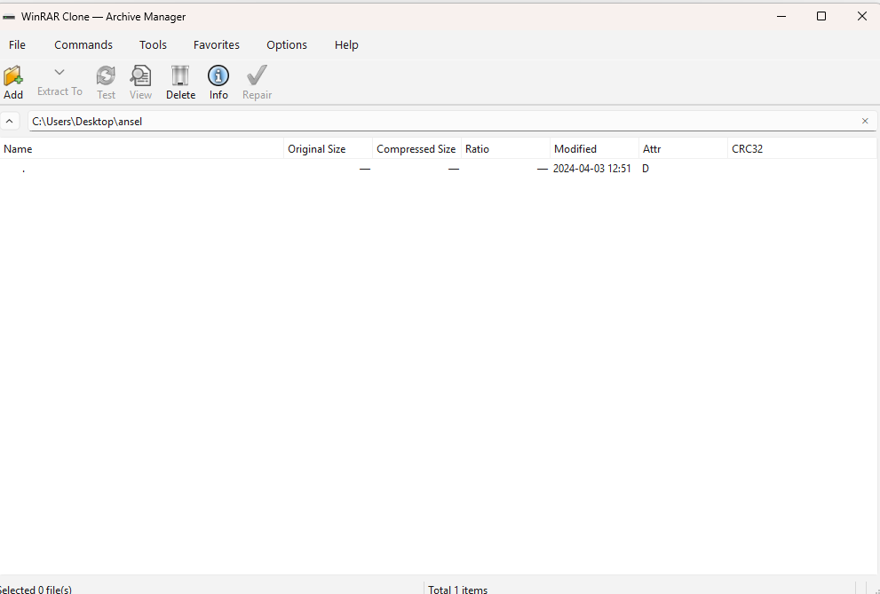

# WinRAR 7.0 Clone Engine

A local desktop archive manager replicating the classic **WinRAR 7.0**
workflow: high-performance compression, giant dictionaries (up to **64 GB**),
a responsive Qt 6 interface and full Windows integration. 100% open source.

| | |
|---|---|
| **Language / Toolkit** | C++20 · Qt 6 (Widgets) |
| **Build system** | CMake ≥ 3.24 + Ninja (MSYS2 / MinGW-w64) |
| **Archive formats** | `.wrc` (open RAR5-style container, native) · `.zip` (native read/write, Zip64) · `.7z` (native write, verified against py7zr/libarchive) · extraction of foreign archives (RAR5, tar, …) via **libarchive** |
| **Crypto** | AES-256-CBC (Windows CNG) · PBKDF2-HMAC-SHA256 (200k) · encrypted file names · encrypt-then-MAC |
| **Platform** | Windows 10/11 (x64) |
| **License** | MIT |

## Features

### Core engine (`src/core`)
- **dictionary_mgr** — RAM safety gate per the specification pseudo-code:
  compression requires `dict * 2` bytes of available RAM; dictionaries up to
  **64 GB** selectable, the encoder window is RAM-bounded while the decoder is
  file-backed (O(1) RAM for any declared dictionary). Solid and Zstd
  extraction use bounded temporary files; LZSS compression buffers one
  file's compressed output in memory.
- **lzss** — LZ77-class codec with configurable dictionary window.
- **compressor / decompressor** — streaming pipelines, CRC32-verified,
  parallel first pass (thread pool), non-blocking UI.
- **Formats** - WSAR (native, per-file Store/Deflate/LZSS/**Zstd**, plus
  **Solid** single-stream blocks), ZIP (Zip64, per-entry methods), 7Z (one
  folder per file, Copy/Deflate codecs).

### Desktop UI (`src/ui`, Qt 6)
Classic WinRAR layout per the specification mock-ups:
- Menu bar: *File, Commands, Tools, Favorites, Options, Help*
- Action toolbar: *Add, Extract To, Test, View, Delete, Info, Repair*
- Address & navigation bar, detailed file list
  (*Name, Original Size, Compressed Size, Ratio, Modified, Attr, CRC32*)
- Tabbed **Archive dialog**: *General / Advanced / Security & Password* —
  format selection, compression method, dictionary selector **1 MB → 64 GB**
  with live RAM check warning, split-to-volumes (700 MB · 4.7 GB · custom),
  Long Range Search, Exhaustive Search, Multi-threaded, AES-256 password +
  *Encrypt file names*.
- Live **progress dialog**: elapsed / remaining / speed, per-file + total
  progress, *Background / Pause / Cancel* — the UI never freezes.

### OS integration (`src/os_integration`, `src/utils`)
- **Long paths** — `\\?\` normalization, > 260 chars up to **65,535**.
- **Mark of the Web** — `Zone.Identifier` ADS read from the archive and
  propagated to every extracted file.
- **Shell context menu** — HKCU registry integration (no admin required).
- Zip-slip protection and hostile-name filtering on extraction.

### CLI (`wrclone.exe`)
```text
wrclone a <archive> <files...> [--format wsar|zip|7z] [-m0..-m6] [--dict 64M]
                                [-v 700M|4.7G] [-p pass] [-hp pass] [--threads N]
wrclone x <archive> [-o outdir] [-p pass]
wrclone t <archive> [-p pass]
wrclone l <archive> [-p pass]
wrclone r <archive> [-p pass]     (repair, .wrc only)
wrclone d <archive> <names...> [-p pass]
wrclone add <path>                (shell-integration entry point: archives
                                   <path> next to itself - used by the
                                   right-click "Add to WRC archive" verb)
```

## Screenshots



## Build (MSYS2 / MinGW-w64)

```powershell
# one-time: install toolchain
D:\msys64\usr\bin\bash.exe -lc "pacman -S --needed --noconfirm `
  mingw-w64-x86_64-gcc mingw-w64-x86_64-cmake mingw-w64-x86_64-ninja `
  mingw-w64-x86_64-qt6-base mingw-w64-x86_64-qt6-tools `
  mingw-w64-x86_64-zlib mingw-w64-x86_64-libarchive"

# build + unit tests
.\scripts\build_msys2.ps1
cd build; ctest --output-on-failure
.\scripts\deploy.ps1   # optional: self-contained dist\ with Qt runtime
```

## Project layout (per Technical Specification §1.b)

```
WinRAR_Clone/
├── src/
│   ├── core/                  # compression engine
│   │   ├── dictionary_mgr.cpp # dictionary memory (RAM allocator)
│   │   ├── compressor.cpp     # streams & algorithms
│   │   ├── decompressor.cpp   # extraction & index reading
│   │   ├── lzss.cpp           # dictionary codec
│   │   └── formats/           # wsar / zip / 7z / libarchive bridge
│   ├── ui/                    # Qt 6 interface
│   │   ├── main_window.cpp    # main screen & file table
│   │   ├── archive_dialog.cpp # compression options & parameters
│   │   └── progress_dialog.cpp# live progress
│   ├── os_integration/
│   │   └── context_menu.cpp   # shell integration (HKCU)
│   └── utils/
│       ├── file_system.cpp    # long paths (>=65535)
│       └── security.cpp       # Mark of the Web + AES-256 (CNG)
├── tests/unit_tests.cpp       # engine regression tests
├── docs/FORMAT_WSAR.md        # native container specification
├── scripts/                   # build / deploy / smoke tests
└── .github/workflows/         # CI (windows-latest, MSYS2)
```

## Notes

- The native `.wrc` container is RAR5-*inspired* but intentionally not
  bit-compatible with any proprietary format — see
  [`docs/FORMAT_WSAR.md`](docs/FORMAT_WSAR.md).
- Dictionary-mode compression (.wrc Normal/Good/Best) compresses files in
  parallel (each file gets its own dictionary window); Store/Fastest/Fast
  (Deflate) also compress files in parallel.
- The images in the original specification are illustrative mock-ups, not
  screenshots of any commercial program.
